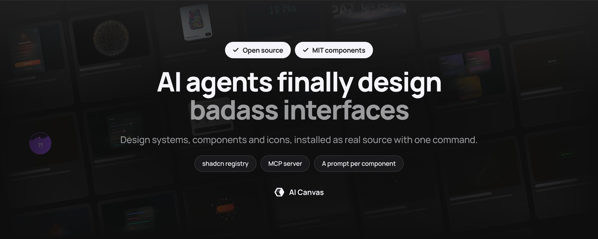

<p align="center">
  <a href="https://aicanvas.me">
    
  </a>
</p>

<h1 align="center">AI Canvas</h1>

<p align="center">
  <em>AI agents finally design badass interfaces.</em>
</p>

<p align="center">
  Complete React design systems for Claude, Codex, Cursor or any AI agent, plus
  <strong>78 free MIT components and blocks</strong> that fit any of them.
  Installed as real source code in your project, never as a dependency.
</p>

<p align="center">
  <a href="https://github.com/birobirobiro/awesome-shadcn-ui"></a>
  <a href="https://github.com/aicanvas-me/aicanvas/stargazers"></a>
  <a href="https://www.npmjs.com/package/@aicanvas/mcp"></a>
  <a href="./LICENSE"></a>
</p>

<p align="center">
  <a href="https://aicanvas.me" title="Browse the live catalog"></a>
</p>

<p align="center"><sub>
  <a href="#quick-start">Quick start</a> ·
  <a href="#whats-inside">What's inside</a> ·
  <a href="#components-by-category">Components</a> ·
  <a href="#design-systems">Design systems</a> ·
  <a href="#for-ai-agents">For AI agents</a> ·
  <a href="https://aicanvas.me/docs">Docs</a> ·
  <a href="./CONTRIBUTING.md">Contributing</a> ·
  <a href="#license">License</a>
</sub></p>

## Quick start

```bash
npx shadcn@latest add @aicanvas/task-cards
```

Starting a new project? `npx shadcn@latest init` first, then add.

<details>
<summary><strong>Registry setup and the free account</strong></summary>

<br />

Reading and copying the code needs no account: every component page on the site
shows its full source, and most of the free library is in this repo under
[`components-workspace/`](./components-workspace).

The one-command CLI install is tied to a free AI Canvas account. Signed out, the
registry hands the CLI a placeholder file instead of the component, so
authenticate once first:

1. [Sign up free](https://aicanvas.me/account/sign-up), then copy your token from
   [account settings](https://aicanvas.me/account/settings).
2. Put it in `.env.local` as `AICANVAS_TOKEN`.
3. Add the registry to your project's `components.json`, once:

```json
{ "registries": { "@aicanvas": { "url": "https://aicanvas.me/r/{name}.json", "params": { "token": "${AICANVAS_TOKEN}" } } } }
```

Every `npx shadcn@latest add @aicanvas/<slug>` is authenticated after that, and
every component page shows a ready tokenized command while you are signed in.
`pnpm dlx`, `yarn dlx` and `bunx` work the same way.

Full details: [Installation](https://aicanvas.me/docs/installation) and
[components.json](https://aicanvas.me/docs/components-json).

</details>

### Requirements

Tailwind CSS **v4**, React 19 and Framer Motion. Components are written against
Tailwind v4 tokens and will not render correctly on v3. The Next.js App Router
is the default target, not a requirement.

## What's inside

| | Free, MIT, in this repo | Premium, proprietary |
| --- | --- | --- |
| **Standalone components and blocks** | 78 | 20 |
| **Design systems** | Andromeda Legacy: 39 components, 4 templates | Andromeda Pro: 69 components, 9 templates |
| **Icons** | Line style, 820 icons | Duotone, Solid, Solid duotone |
| **Remix prompts** | One per free component | One per Premium component |

Premium pays for the free library, and the free library stays free: MIT means you
can use it in commercial work, change it, and ship it without attribution. The
Premium lane is a separate, closed-source catalog, never a crippled free tier.

## Components by category

Every row links to the live catalog, where each component has a running preview,
its full source and its remix prompt.

| Category | Free | What's in it |
| --- | --- | --- |
| [Cards & Modals](https://aicanvas.me/components/category/cards-modals) | 17 | Card stacks, decks, dialogs, drag-to-browse galleries |
| [Glass](https://aicanvas.me/components/category/glass) | 17 | A full glassmorphism set: dock, modal, navbar, player, tabs |
| [Backgrounds](https://aicanvas.me/components/category/backgrounds) | 14 | Canvas and WebGL fields: waves, noise, particles, grids |
| [Widgets](https://aicanvas.me/components/category/widgets) | 12 | Self-contained pieces: clocks, charging, swap, signature pad |
| [Typography](https://aicanvas.me/components/category/typography) | 10 | Scramble, blur reveal, kinetic and variable-weight text |
| [Buttons & Toggles](https://aicanvas.me/components/category/buttons-toggles) | 8 | Theme toggles, glitch and magnetic buttons, switches |
| [Blocks](https://aicanvas.me/components/category/blocks) | 7 | Whole page sections: job cards, task boards, wipe galleries |
| [Navigation](https://aicanvas.me/components/category/navigation) | 6 | Tab bars, docks, radial toolbars, navbars |
| [Inputs & Controls](https://aicanvas.me/components/category/inputs-controls) | 5 | AI composers, sliders, pickers |
| [3D & Shaders](https://aicanvas.me/components/category/3d-shaders) | 4 | Three.js spheres, lines and shader surfaces |
| [Notifications](https://aicanvas.me/components/category/notifications) | 3 | Toasts and notification stacks |

<p align="center">
  <a href="https://aicanvas.me/components/tilted-coverflow"></a>
  <a href="https://aicanvas.me/components/crypto-swap"></a>
  <a href="https://aicanvas.me/components/signature-pad"></a>
  <a href="https://aicanvas.me/components/product-card-deck"></a>
  <a href="https://aicanvas.me/components/glass-ai-compose"></a>
  <a href="https://aicanvas.me/components/ai-job-cards"></a>
</p>

<p align="center"><sub><a href="https://aicanvas.me">Browse all 98 components at aicanvas.me</a></sub></p>

## Design systems

A design system is tokens, components and the rules that hold them together, so
an agent can build a whole screen instead of pasting one card.

```bash
npx shadcn@latest add @aicanvas/andromeda          # the free system, 39 components
```

**Andromeda Legacy** is MIT and lives in
[`design-systems/andromeda/`](./design-systems/andromeda): tokens, components,
utilities and four templates. **Andromeda Pro** is the Premium rebuild with 69
components, nine templates, light and dark.

Each system ships an **AI Brain**: the written rules an agent reads before it
writes a line, so what it builds matches the system instead of guessing.
[Read more](https://aicanvas.me/docs/ai-brain).

## For AI agents

Point your agent at the catalog and it searches, reads and installs on its own.

```bash
claude mcp add aicanvas -- npx -y @aicanvas/mcp
```

Or in any MCP config:

```json
{ "mcpServers": { "aicanvas": { "command": "npx", "args": ["-y", "@aicanvas/mcp"] } } }
```

Works with Claude Code, Codex, Cursor and any MCP-compatible editor. The server
is read-only and fetches the live registry at runtime, so new components reach
your agent shortly after they ship.

Plain-text surfaces, no MCP needed:

| Surface | What it is |
| --- | --- |
| [`/llms.txt`](https://aicanvas.me/llms.txt) | The whole catalog as a map, for a model to read in one request |
| [`/llms-full.txt`](https://aicanvas.me/llms-full.txt) | Every page's content, flattened |
| `/components/<slug>.md` | Any page as Markdown. Add `.md` to any URL |
| Remix prompts | One comprehensive, platform-agnostic prompt per component. Paste it into any AI tool to rebuild that component your way |

More: [MCP docs](https://aicanvas.me/docs/mcp) ·
[Agent files](https://aicanvas.me/docs/agent-files) ·
[Remix prompts](https://aicanvas.me/docs/remix-prompts)

## Why it is built this way

- **Finished components, not headless primitives.** You get the animation, the
  states and the polish, not a styling exercise.
- **Real source, yours to keep.** Installing copies the code into your project.
  Restyle it, extend it, or ship it as is. There is no AI Canvas package to keep
  in sync, and nothing changes under you.
- **Built for agents, readable by humans.** A design system with written rules, a
  registry the CLI understands, an MCP server, and one remix prompt per piece.
- **Animated by default.** Framer Motion and Tailwind v4 throughout, Three.js
  where a piece is genuinely 3D.

## Repository layout

This repo is the real product: the website **and** the free component library.

| Path | What's there |
| --- | --- |
| [`components-workspace/<slug>/`](./components-workspace) | Each free component: `index.tsx` source and its `prompts.ts` remix prompt, plus a `spec.md` on many |
| [`design-systems/andromeda/`](./design-systems/andromeda) | The free Andromeda Legacy source: tokens, components, utilities |
| [`app/`](./app) | The aicanvas.me website (Next.js App Router) |
| [`app/lib/component-registry.tsx`](./app/lib/component-registry.tsx) | The catalog index. Append-only: slugs are a public contract |
| [`mcp/`](./mcp) | The `@aicanvas/mcp` server published to npm |
| [`scripts/generate-registry.mjs`](./scripts/generate-registry.mjs) | Builds the shadcn registry JSON from the sources above |
| `CLAUDE.md`, `AGENTS.md`, [`supervisor/`](./supervisor), [`reviewer/`](./reviewer), [`skills/`](./skills) | The rules the project's own AI agents follow when they build here. Shipped on purpose: this library is built the way it tells you to build |

The `@aicanvas` registry files served at `/r/*.json` are **generated at build
time** from the sources above, so there is no checked-in `registry/` folder.
`npm run generate` produces them locally.

Premium components are not in this repo. They live in a private vault and are
injected at build time, so a clone builds the free library only.

## Running it locally

```bash
git clone https://github.com/aicanvas-me/aicanvas.git
cd aicanvas
npm install
npm run dev
```

http://localhost:3001 serves the whole free catalog with no API keys.
[CONTRIBUTING.md](./CONTRIBUTING.md) covers what each key unlocks, the checks CI
runs, and how to add a component.

## Common questions

**Do I need an account?**
Not to read or copy the code. Every component page shows its full source, and
most of the free library is in this repo. A free account is only needed for the
one-command `npx shadcn add` install.

**Does it work outside Next.js?**
Yes. Components are plain React and TypeScript with Tailwind and Framer Motion.
A few load their display font through `next/font/google`; outside Next.js, swap
that import for your own font loader.

**Do I get a dependency or real code?**
Real code, copied into your project. There is nothing to keep in sync.

**Can I use it commercially?**
Yes, the free library is MIT: commercial use, modification, no attribution
required. Premium is licensed separately, see [License](#license).

**How do I keep components up to date?**
You do not have to. Once installed, the code is yours. Re-run the install
command if you want the latest version of a component.

## Contributing

New components ship regularly, and issues, ideas and pull requests are welcome.
[CONTRIBUTING.md](./CONTRIBUTING.md) has the local setup and the checks;
[open an issue](https://github.com/aicanvas-me/aicanvas/issues/new/choose) to
suggest a component or report a bug.

If AI Canvas saves you time,
[a star](https://github.com/aicanvas-me/aicanvas/stargazers) helps more builders
find it.

## License

The free library is MIT. Use it in personal and commercial projects, modify it
freely, and ship it without attribution. See [LICENSE](./LICENSE). Premium
components, design systems and templates are proprietary under the AI Canvas
Premium License. Security reports: [SECURITY.md](./SECURITY.md).
