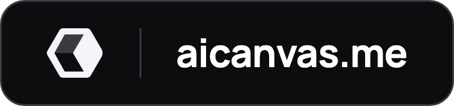

<p align="center">
  <a href="https://aicanvas.me">
    
  </a>
</p>

<h1 align="center">AI Canvas</h1>

<p align="center">
  <strong>Finished components, not headless primitives.</strong><br />
  A complete React design system for Claude, Codex, Cursor or any AI agent, plus
  <strong>78 free MIT components and blocks</strong> that fit it or any other
  stack, installed as real source code in your project, never as a dependency.
</p>

<p align="center">
  <a href="https://github.com/birobirobiro/awesome-shadcn-ui"></a>
  <a href="https://github.com/aicanvas-me/aicanvas/stargazers"></a>
  <a href="https://www.npmjs.com/package/@aicanvas/mcp"></a>
  <a href="./LICENSE"></a>
</p>

<p align="center">
  <a href="https://aicanvas.me" title="Browse the live catalog"></a>
</p>

<p align="center"><sub>
  <a href="#quick-start">Quick start</a> ·
  <a href="#whats-inside">What's inside</a> ·
  <a href="#components-by-category">Components</a> ·
  <a href="#design-systems">Design systems</a> ·
  <a href="#for-ai-agents">For AI agents</a> ·
  <a href="https://aicanvas.me/docs">Docs</a> ·
  <a href="./CONTRIBUTING.md">Contributing</a> ·
  <a href="#license">License</a>
</sub></p>

## Quick start

```bash
npx shadcn@latest add @aicanvas/task-cards
```

Starting a new project? `npx shadcn@latest init` first, then add.

**Signed out, that command writes a placeholder file instead of the component.**
The CLI install is tied to a free AI Canvas account, and the setup below takes a
minute. Signed out you can still install every Line icon
(`npx shadcn@latest add @aicanvas/icon-search`, or `@aicanvas/icons` for all 820)
and the design-system foundation (`@aicanvas/andromeda-tokens`), and reading or
copying source is free to everyone, on every component page and in this repo
under [`components-workspace/`](./components-workspace).

<details>
<summary><strong>Set up the registry once</strong></summary>

<br />

Authenticate first and the install works from then on:

1. [Sign up free](https://aicanvas.me/account/sign-up), then copy your token from
   [account settings](https://aicanvas.me/account/settings).
2. Put it in `.env.local` as `AICANVAS_TOKEN`.
3. Add the registry to your project's `components.json`, once:

```json
{ "registries": { "@aicanvas": { "url": "https://aicanvas.me/r/{name}.json", "params": { "token": "${AICANVAS_TOKEN}" } } } }
```

Every `npx shadcn@latest add @aicanvas/<slug>` is authenticated after that, and
every component page shows a ready tokenized command while you are signed in.
`pnpm dlx`, `yarn dlx` and `bunx` work the same way. The same account covers the
free design system and its templates.

Full details: [Installation](https://aicanvas.me/docs/installation) and
[components.json](https://aicanvas.me/docs/components-json).

</details>

### Requirements

Tailwind CSS **v4**, React 19, and Framer Motion for most components. Written against
Tailwind v4 tokens and will not render correctly on v3. The Next.js App Router
is the default target, not a requirement.

## What's inside

| | Free | Premium, proprietary |
| --- | --- | --- |
| **Standalone components and blocks** | 78, MIT, in this repo | 20 |
| **Design systems** | Andromeda Legacy: 39 components, 4 templates, MIT, in this repo | Andromeda Pro: 69 components, 9 templates |
| **Icons** | Line style, 820 icons, free with a credit line | Duotone, Solid, Solid duotone |
| **Remix prompts** | One per free component | The setup is public, the rest needs Premium |
| **AI Brain**, the rules an agent reads before it builds | Andromeda Legacy's own rules file, in this repo | The installable Brain, for both systems |
| **[Agent skills](https://aicanvas.me/skills)** | — | Premium, installed through the MCP server |

The icons are the one free thing that is not MIT and not in this repo: they are
drawn in a private source and served through the registry. They install with no
account at all, on two conditions: keep the one-line AI Canvas notice at the top
of each icon file, and name AI Canvas in your credits or licence file when you
publish your source. Full terms:
[Licensing](https://aicanvas.me/docs/licensing) and the
[Premium License](https://aicanvas.me/premium-license).
[Pricing](https://aicanvas.me/pricing) covers what Premium costs.

[Premium](https://aicanvas.me/pricing) pays for the free library, and the free
library stays free: MIT means you
can use it in commercial work, change it and ship it, with no credit in your app
and no permission to ask. The MIT notice travels with the code, as MIT requires.
The Premium lane is a separate, closed-source catalog, not a crippled free tier.

## Components by category

Every row links to the live catalog, where each component has a running preview,
its full source and its remix prompt. A component can sit in two categories, so
the column does not add up to 78, and each page also lists that category's
Premium items, which the column does not count.

| Category | Free | What's in it |
| --- | --- | --- |
| [Cards & Modals](https://aicanvas.me/components/category/cards-modals) | 17 | Card stacks, decks, dialogs, drag-to-browse galleries |
| [Glass](https://aicanvas.me/components/category/glass) | 17 | A full glassmorphism set: dock, modal, navbar, player, tabs |
| [Backgrounds](https://aicanvas.me/components/category/backgrounds) | 14 | Canvas and WebGL fields: waves, noise, particles, grids |
| [Widgets](https://aicanvas.me/components/category/widgets) | 12 | Clocks, calendars, players, meters, a signature pad, a token swap |
| [Typography](https://aicanvas.me/components/category/typography) | 10 | Scramble, blur reveal, kinetic and variable-weight text |
| [Buttons & Toggles](https://aicanvas.me/components/category/buttons-toggles) | 8 | Theme toggles, glitch and magnetic buttons, switches |
| [Blocks](https://aicanvas.me/components/category/blocks) | 7 | Whole page sections: job cards, task boards, wipe galleries |
| [Navigation](https://aicanvas.me/components/category/navigation) | 6 | Navbars, tab bars, docks, sidebars, user menus |
| [Inputs & Controls](https://aicanvas.me/components/category/inputs-controls) | 5 | AI composers, sliders, steppers, search bars, radial toolbars |
| [3D & Shaders](https://aicanvas.me/components/category/3d-shaders) | 4 | A Three.js particle sphere, halo type, a cube carousel |
| [Notifications](https://aicanvas.me/components/category/notifications) | 3 | Toasts, notification cards, tag stacks |

The catalog carries a twelfth category, AI Agent UI, with 11 components. Every
one of them is Premium, so it has no row here.

<p align="center">
  <a href="https://aicanvas.me/components/tilted-coverflow"></a>
  <a href="https://aicanvas.me/components/crypto-swap"></a>
  <a href="https://aicanvas.me/components/signature-pad"></a>
  <a href="https://aicanvas.me/components/product-card-deck"></a>
  <a href="https://aicanvas.me/components/glass-ai-compose"></a>
  <a href="https://aicanvas.me/components/ai-job-cards"></a>
</p>

<p align="center"><sub><a href="https://aicanvas.me">Browse all 98 components at aicanvas.me</a></sub></p>

## Design systems

A design system is tokens, components and the rules that hold them together, so
an agent can build a whole screen instead of pasting one card.

```bash
npx shadcn@latest add @aicanvas/andromeda          # the free system, 39 components
```

Same free account as a single component. Signed out it writes 42 placeholder
files you then have to delete, so sign in first.

**Andromeda Legacy** is MIT and lives in
[`design-systems/andromeda/`](./design-systems/andromeda): tokens, components,
utilities, and four templates under `examples/` (which holds a fifth that is not
published). **Andromeda Pro** is the Premium rebuild with 69
components, nine templates, light and dark.

Each system has an **AI Brain**: the written rules an agent reads before it
writes a line, so what it builds matches the system instead of guessing.
Andromeda Legacy's rules are in this repo at
[`design-systems/andromeda/rules.md`](./design-systems/andromeda/rules.md), MIT
like the rest of it. The *installable* Brain, the one the CLI and the MCP server
hand to an agent, is Premium for both systems.
[Read more](https://aicanvas.me/docs/ai-brain).

## For AI agents

Point your agent at the catalog and it searches, reads and installs on its own.

```bash
claude mcp add aicanvas -- npx -y @aicanvas/mcp
```

Or in any MCP config:

```json
{ "mcpServers": { "aicanvas": { "command": "npx", "args": ["-y", "@aicanvas/mcp"] } } }
```

Works with Claude Code, Codex, Cursor and any MCP-compatible editor. Every tool
on the server only reads, and it fetches the live registry at runtime, so new
components reach your agent shortly after they ship. The one thing that writes is
the package's own `skill add` command, which installs a Premium agent skill into
your skills folder when you run it yourself.

Plain-text surfaces, no MCP needed:

| Surface | What it is |
| --- | --- |
| [`/llms.txt`](https://aicanvas.me/llms.txt) | The whole catalog as a map, for a model to read in one request |
| [`/llms-full.txt`](https://aicanvas.me/llms-full.txt) | Every page's content, flattened |
| `/components/<slug>.md` | A page as Markdown. Add `.md` to the catalog, a component, a design system or a template (not to a category) |
| Remix prompts | One comprehensive, platform-agnostic prompt per component. Paste it into any AI tool to rebuild that component your way |

More: [MCP docs](https://aicanvas.me/docs/mcp) ·
[Agent files](https://aicanvas.me/docs/agent-files) ·
[Remix prompts](https://aicanvas.me/docs/remix-prompts)

## Why it is built this way

- **Finished components, not headless primitives.** You get the animation, the
  states and the polish, not a styling exercise.
- **Real source, yours to keep.** Installing copies the code into your project.
  Restyle it, extend it, or ship it as is. There is no AI Canvas package to keep
  in sync, and nothing changes under you.
- **Built for agents, readable by humans.** A design system with written rules, a
  registry the CLI understands, an MCP server, and one remix prompt per piece.
- **Animated by default.** Framer Motion for anything that animates in the DOM,
  canvas or WebGL for the 15 that paint their own pixels, Three.js where a piece
  is genuinely 3D. Tailwind v4 throughout.

## Repository layout

This repo is the real product: the website **and** the free component library.

| Path | What's there |
| --- | --- |
| [`components-workspace/<slug>/`](./components-workspace) | Each free component: `index.tsx` source and its `prompts.ts` remix prompt, plus a `spec.md` on many, and `_template` and `skills` alongside them |
| [`design-systems/andromeda/`](./design-systems/andromeda) | The free Andromeda Legacy source: tokens, components, utilities, and `rules.md`, its design rules |
| [`app/`](./app) | The aicanvas.me website (Next.js App Router) |
| [`app/lib/component-registry.tsx`](./app/lib/component-registry.tsx) | The catalog index. Append-only: slugs are a public contract |
| [`mcp/`](./mcp) | The `@aicanvas/mcp` server published to npm |
| [`scripts/generate-registry.mjs`](./scripts/generate-registry.mjs) | Builds the shadcn registry JSON from the sources above |
| `CLAUDE.md`, `AGENTS.md`, [`supervisor/`](./supervisor), [`reviewer/`](./reviewer), [`skills/`](./skills) | The rules the project's own AI agents follow when they build here. Shipped on purpose: this library is built the way it tells you to build |

The `@aicanvas` registry files served at `/r/*.json` are **generated at build
time** from the sources above, so there is no checked-in `registry/` folder.
`npm run generate` produces them locally.

Premium components are not in this repo. They live in a private vault and are
injected at build time, so a clone builds the free library only.

## Running it locally

```bash
git clone https://github.com/aicanvas-me/aicanvas.git
cd aicanvas
npm install
npm run dev
```

http://localhost:3001 serves the whole free catalog with no API keys.
[CONTRIBUTING.md](./CONTRIBUTING.md) covers what the optional keys unlock, the
checks CI runs, and how to add a component.

## Common questions

**Do I need an account?**
Not to read or copy the code. Every component page shows its full source, and
every free component and the free design system are in this repo. A free account
is only needed for the one-command `npx shadcn add` install.

**Does it work outside Next.js?**
Yes. Components are plain React and TypeScript with Tailwind and Framer Motion.
A few pull a display font from Google Fonts with a CSS `@import`; swap that line
if you self-host your fonts.

**Do I get a dependency or real code?**
Real code, copied into your project. There is nothing to keep in sync.

**Can I use it commercially?**
Yes, the free library is MIT: commercial use, modification, no credit in your
app. Keep the MIT notice with the code. Premium is licensed separately, see
[License](#license).

**How do I keep components up to date?**
You do not have to. Once installed, the code is yours. Re-run the install
command if you want the latest version of a component.

## Contributing

New components ship regularly, and issues, ideas and pull requests are welcome.
[CONTRIBUTING.md](./CONTRIBUTING.md) has the local setup and the checks;
[open an issue](https://github.com/aicanvas-me/aicanvas/issues/new/choose) to
suggest a component or report a bug.

If AI Canvas saves you time,
[a star](https://github.com/aicanvas-me/aicanvas/stargazers) helps more builders
find it.

## License

[LICENSE](./LICENSE) is MIT and covers this repository: the components, the free
design system and the site code you are reading. Use it in personal and
commercial projects, modify it freely, and ship it with no credit in your app,
keeping the MIT notice with the code. Premium
components, design systems and templates are proprietary under the AI Canvas
Premium License. Security reports: [SECURITY.md](./SECURITY.md).
